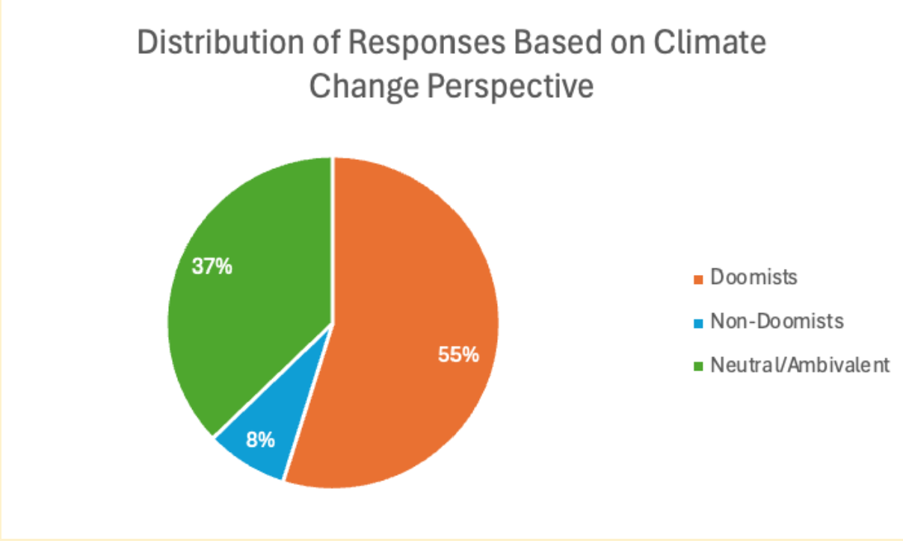

# Climate Doomism at McMaster: Does Feeling Hopeless Mean Giving Up?
### Public Executive Summary by Claire Chisholm, Saniyah Farzeen, Griffin Suk, Leah Vadakken, Michelle Zhang

## Introduction and Background
With increasingly alarming news about climate change, it can be difficult to remain hopeful about the future. For some, this concern develops into climate doomism, which is the belief that climate change has progressed too far for meaningful action to make a difference. Previous research suggests that people who view climate change as unstoppable may be less willing to change their environmental behaviours, and young people, in particular, are at risk of being psychologically affected by climate change (Mayer and Smith 2019; Patrick et al. 2023). However, research on the prevalence of climate doomist perspectives and it impacts pro-climate action, institutional trust, and differs across demographic groups is limited.
Our study explores the prevalence of climate doomism among McMaster University undergraduate students and whether these beliefs are associated with certain environmental habits, demographic characteristics, and political perspectives.

## Methods
Between October 30 and November 9, 2026, we surveyed 121 McMaster undergraduate students through an anonymous online questionnaire. We developed a Climate Doomism Score using three questions about whether climate change feels unavoidable, its potential future impacts, and avoidance of personal responsibility. Students were classified as climate doomists, non-doomists, or neutral/ambivalent based on their scores. The survey also included questions on environmental behaviours, demographics, political engagement, and trust in government.

## Results
Of the 121 students surveyed, 8 dropped out of the survey, leaving 113 for statistical analysis. 54.9% of respondents were classified as climate doomists, while 37.2% were neutral/ambivalent and 8.0% were non-doomists (Figure 1).

 

 _Figure 1. Climate doomism classifications among 113 surveyed McMaster University undergraduate students. Students were grouped based on their responses to questions about climate change being unavoidable, its future impacts, and avoidance of personal responsibility_

Interestingly, students classified as climate doomists did not report significantly less environmental action than other groups. Neutral/ambivalent students actually reported the lowest average engagement, although these differences were not statistically significant. We also found no significant associations between doomism and the demographic or political factors examined.

## Discussion

These findings suggest that feeling pessimistic about climate change does not necessarily prevent people from taking environmental action. Someone might feel discouraged about the future but still recycle, conserve energy, or purchase second-hand clothing. Previous research has similarly found that climate despair can coexist with environmental action (Bird et al. 2024).
Government trust may also be more complicated than expected. Although research has linked young people's climate anxiety to dissatisfaction with government responses (Hickman et al. 2021), frustration with political institutions does not necessarily mean they believe climate action is pointless.

## Limitations
Our study involved a relatively small, non-random sample, so the findings cannot represent all McMaster students. Additionally, our climate doomism scoring system was developed specifically for this project and is not independently validated. Some responses may therefore reflect general climate concern rather than doomism. Behaviours and opinions were also self-reported.

## Conclusions
While more than half of surveyed students met our study's definition of climate doomism, we found no significant evidence that these beliefs were associated with reduced environmental action, differed across demographics or institutional trust. Our findings highlight the importance of recognizing students' climate concerns without assuming they have stopped trying to make a difference. Universities can help by providing accessible opportunities for students to participate in climate action.

## References 
References
Bird, Lucy H., Emma F. Thomas, Michael Wenzel, and Morgana Lizzio-Wilson. 2024. “Thinking About the Future: Examining the Exacerbating and Attenuating Factors of Despair-Induced Climate Burnout.” Journal of Environmental Psychology 98: 102382. https://doi.org/10.1016/j.jenvp.2024.102382.

Hickman, Caroline, Elizabeth Marks, Panu Pihkala, Susan Clayton, R. Eric Lewandowski, Elouise E. Mayall, Britt Wray, Catriona Mellor, and Lise Van Susteren. 2021. “Climate Anxiety in Children and Young People and Their Beliefs about Government Responses to Climate Change: A Global Survey.” The Lancet Planetary Health 5 (12): e863–73. https://doi.org/10.1016/S2542-5196(21)00278-3.

Mayer, Adam, and E. Keith Smith. 2019. “Unstoppable Climate Change? The Influence of Fatalistic Beliefs about Climate Change on Behavioural Change and Willingness to Pay Cross-Nationally.” Climate Policy 19 (4): 511–23. https://doi.org/10.1080/14693062.2018.1532872.

Patrick, Rebecca, Tristan Snell, Hasini Gunasiri, Rhonda Garad, Graham Meadows, and Joanne Enticott. 2023. “Prevalence and Determinants of Mental Health Related to Climate Change in Australia.” Australian & New Zealand Journal of Psychiatry 57 (5): 710–24. https://doi.org/10.1177/00048674221107872

